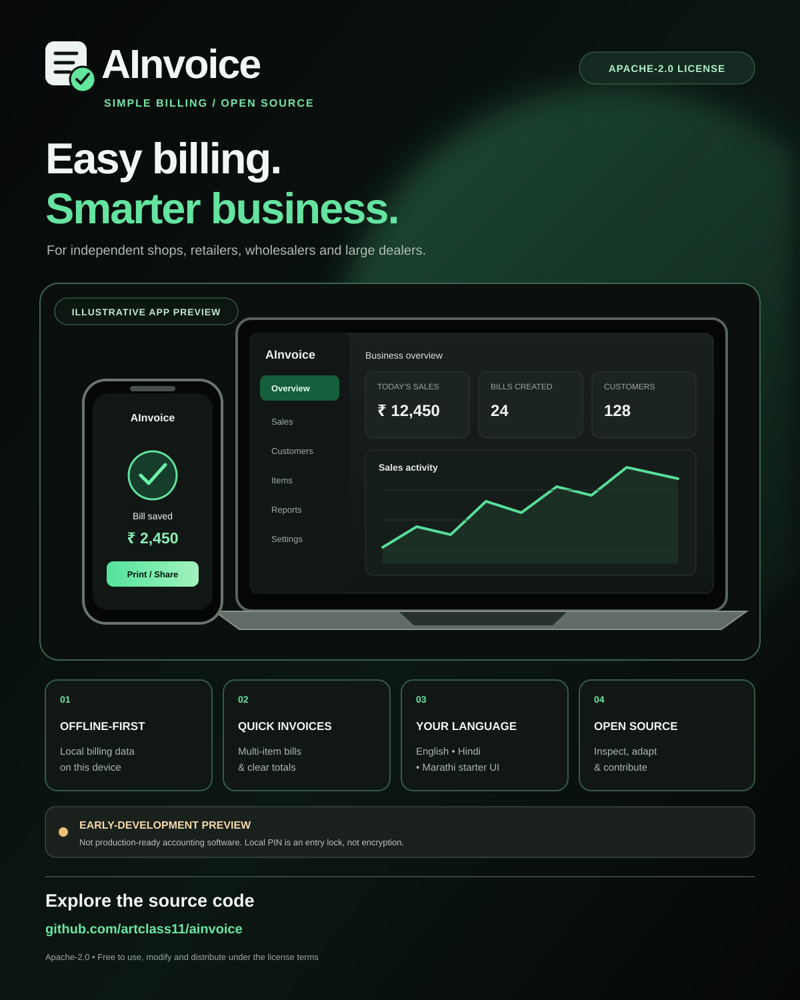

# AInvoice

**Easy billing. Smarter business.**

AInvoice is an open-source, offline-first billing application for independent shops, retailers, wholesalers and large dealers. The default workflow is designed for non-technical users; the underlying data model is being expanded for larger operations.

## Open source

AInvoice is licensed under **Apache License 2.0**. You may use it commercially, inspect the source, modify it, redistribute it and build services from it, subject to the license terms. See [LICENSE](./LICENSE) and [CONTRIBUTING.md](./CONTRIBUTING.md).

## Project poster

Download the [AInvoice project poster (SVG)](./assets/ainvoice-project-poster.svg).

## Supported platforms

AInvoice has two delivery options:

- **Installable PWA:** Windows, macOS, Linux, Android and iOS/iPadOS through supported browsers.
- **Tauri native application:** native build targets for Windows, macOS, Linux, Android and iOS from the shared frontend.

Native packaging and signing requirements vary by platform. Windows/macOS/Linux installers are built on version tags. Android requires a private upload keystore in GitHub Actions secrets. iOS requires Apple signing certificates and provisioning. Do not mistake a shared codebase for completed platform certification.

See [PLATFORMS.md](./docs/PLATFORMS.md) for platform details and installation/build steps.

## Current application features

- Guided local business setup and a 4–6 digit app-entry PIN.
- English, Hindi and Marathi interface foundations.
- Local product catalogue with SKU uniqueness, unit, sale/purchase prices, tax category and optional stock tracking.
- Customer book with contact details, tax ID, opening balance and credit limit.
- Multi-item sales invoices with quantity, line discount, configurable tax rate, notes and payment capture.
- Partial payments, cash/UPI/bank/card/other payment methods and a cash-book view.
- Stock decrement on tracked-item sales; stock restoration when an unpaid invoice is voided.
- Invoice search, print layout, basic sales/collections reports and low-stock count.
- Supplier book, purchase documents, tracked-stock receipts, supplier payments and supplier payable balances; unpaid purchase voiding is restricted to unused received stock.
- Audit events for core local business changes.
- Password-encrypted backup export and restore using AES-256-GCM.

## Promotional video — Hindi

A 25-second vertical Hindi promotional cut has been created for AInvoice. The repository contains its [production notes](./marketing/hindi-promo-2026-11/README.md), [Hindi subtitles](./marketing/hindi-promo-2026-11/ainvoice_promo_hindi.srt), [voiceover script](./marketing/hindi-promo-2026-11/hindi_voiceover_script.md), [shot manifest](./marketing/hindi-promo-2026-11/shot_manifest.json) and [technical QC report](./marketing/hindi-promo-2026-11/QC_REPORT.json).

The encoded MP4 master was delivered separately and is not stored in this Git commit. The current master includes original instrumental music and Hindi on-screen text, but does not yet include spoken narration; human creative review is also pending. See the QC report before using it publicly.

## Development

Requires Node.js 22+, pnpm 9+ and Rust stable for native builds.

    pnpm install
    pnpm dev
    pnpm test
    pnpm typecheck
    pnpm build

Run as a native desktop app:

    pnpm tauri dev

Build a native desktop installer on the current OS:

    pnpm tauri build

Initialize and build Android:

    pnpm tauri android init
    pnpm tauri android build --apk --split-per-abi

Initialize and build iOS on macOS with Xcode and Apple signing:

    pnpm tauri ios init
    pnpm tauri ios build

## Web app for phones and tablets

A GitHub Pages deployment workflow is included for a browser-installable PWA. After enabling **Settings → Pages → Build and deployment → GitHub Actions** once, open https://artclass11.github.io/ainvoice/ on Android or Safari on iPhone/iPad and use the browser's Install / Add to Home Screen option. The web app is also useful on desktop browsers.

## Platform downloads — AInvoice early access

Choose an installer for your device. Version 0.1.1 is the newest release; older verified installers remain linked where a refreshed package is still being retried. These are preview builds, not production-certified accounting software.

| Platform | Download | Status |
|---|---|---|
| Windows 10/11 (64-bit) | [EXE installer](https://github.com/artclass11/ainvoice/releases/download/app-v0.1.0/AInvoice_0.1.0_x64-setup.exe) · [MSI installer](https://github.com/artclass11/ainvoice/releases/download/app-v0.1.0/AInvoice_0.1.0_x64_en-US.msi) | Verified 0.1.0; refreshed 0.1.1 bundle retry pending |
| macOS Apple Silicon (M1/M2/M3/M4) | [0.1.1 ARM64 DMG](https://github.com/artclass11/ainvoice/releases/download/app-v0.1.1/AInvoice_0.1.1_aarch64.dmg) | Latest verified build |
| macOS Intel | [0.1.1 Intel x64 DMG](https://github.com/artclass11/ainvoice/releases/download/app-v0.1.1/AInvoice_0.1.1_x64.dmg) | Latest verified build |
| Android (ARM64) | [Debug preview APK](https://github.com/artclass11/ainvoice/releases/download/app-v0.1.0/AInvoice_0.1.0_android_arm64_debug.apk) | Verified 0.1.0 debug-signed preview; 0.1.1 build retry in progress |
| iPhone / iPad (iOS) | [iOS build workflow](https://github.com/artclass11/ainvoice/actions/workflows/ios.yml) | No installable IPA published; Apple signing and provisioning required |
| Linux (64-bit) | [AppImage](https://github.com/artclass11/ainvoice/releases/download/app-v0.1.0/AInvoice_0.1.0_amd64.AppImage) · [DEB](https://github.com/artclass11/ainvoice/releases/download/app-v0.1.0/AInvoice_0.1.0_amd64.deb) · [RPM](https://github.com/artclass11/ainvoice/releases/download/app-v0.1.0/AInvoice-0.1.0-1.x86_64.rpm) | Verified 0.1.0; refreshed 0.1.1 bundle retry pending |

[Open all AInvoice releases](https://github.com/artclass11/ainvoice/releases) · [Source code](https://github.com/artclass11/ainvoice)

**Install notes:** Windows and macOS packages are unsigned early-access builds, so the operating system may show an unknown-publisher warning. Android APK is a debug-signed device preview, not the permanent production signing key; it cannot receive in-place updates from a future package signed by a different private key. Do not use preview builds as the only copy of live business data. iOS needs Apple Developer signing and provisioning; the workflow above is not an App Store download.

## Important security and compliance status

AInvoice is in **early development**, not yet a production-ready accounting or tax system.

- The PIN is an app-entry gate, not database encryption.
- Live browser/WebView IndexedDB data is not automatically encrypted at rest.
- Exported backup files are encrypted, but losing the backup password makes the backup unrecoverable.
- First-stage supplier and purchase ledgers are implemented, but supplier opening balances, supplier returns/refunds, debit notes, sales credit notes, double-entry accounting, bank reconciliation, multi-user permissions, branch/tenant isolation, encrypted multi-device sync and independent security testing are not complete.
- GST, e-invoicing, IRN, e-way bills and other statutory features must not be treated as compliant until current official rules and qualified review are incorporated.

Read [SECURITY.md](./SECURITY.md) and [ENTERPRISE_READINESS.md](./docs/ENTERPRISE_READINESS.md) before entering live business records.

## Product and engineering documents

- [Product specification](./docs/PRODUCT_SPEC.md)
- [Architecture](./docs/ARCHITECTURE.md)
- [Platform builds and downloads](./docs/PLATFORMS.md)
- [Enterprise readiness plan](./docs/ENTERPRISE_READINESS.md)
- [Engineering quality scorecard and production gates](./docs/QUALITY_SCORECARD.md)
- [Roadmap](./docs/ROADMAP.md)
- [DeepSeek Harness workflow](./DEEPSEEK_HARNESS.md)
- [Agent instructions](./AGENTS.md)

## License

Apache-2.0. Third-party dependencies and optional integrations retain their own licenses.
